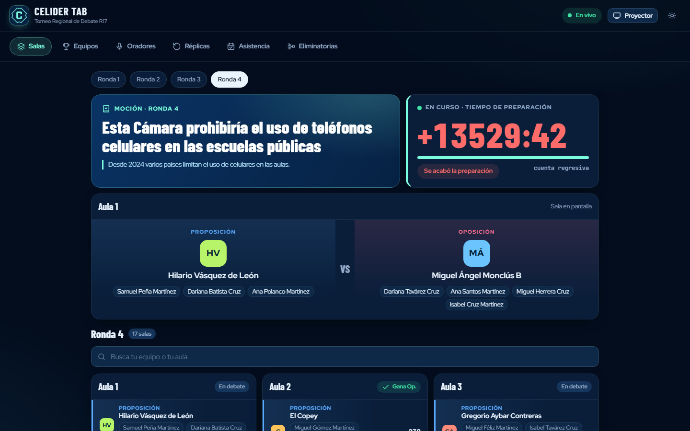

<div align="center">

# CELIDER Tab

**Tabulador en vivo para torneos de debate en formato WSDC**

Hecho para el Torneo Regional de Debate R17 · República Dominicana

[**Ver en vivo →**](https://celider-tab.vercel.app/?t=demo#vivo)



</div>

## Qué es

Un tabulador propio, en la línea de Tabbycat, pensado para que un torneo de debate escolar corra sin papeles. La administración arma las rondas desde la computadora, cada juez llena su boleta desde el teléfono con un enlace propio y el público ve las salas, las mociones y los resultados en tiempo real en una pantalla o en su teléfono.

## Lo que hace

- **Portal público en vivo:** salas de cada ronda, moción y contexto, cuenta regresiva de la preparación, equipos, oradores, réplicas, asistencia y eliminatorias. Tiene modo **proyector** para la pantalla grande.
- **Portal del juez:** cada juez entra con su propio enlace (`#j/<token>`) y solo puede enviar las boletas de las salas que le tocan.
- **Administración con PIN:** equipos, jueces, emparejamientos, mociones (con un banco de mociones para las próximas rondas), publicación de salas y resultados.
- **Tiempo real:** lo que guarda la administración o envía un juez aparece al instante en todas las pantallas.
- **Datos protegidos:** la página pública lee una copia sin datos sensibles. Los datos privados solo se leen y se guardan por funciones de la base que piden el PIN o el token del juez.

## Cómo está hecho

| Parte | Tecnología |
|---|---|
| Interfaz | JavaScript sin frameworks, HTML y CSS (tema oscuro y claro) |
| Base de datos | Supabase (PostgreSQL) con RLS y funciones RPC |
| Tiempo real | Supabase Realtime |
| Publicación | Vercel |

```
app/
├── index.html    · estructura y carga
├── nucleo.js     · estado del torneo, rondas y puntajes
├── vistas.js     · pantallas de la administración
├── portal.js     · portal público, portal del juez y acceso
├── nube.js       · sincronización y tiempo real con Supabase
├── iconos.js     · íconos SVG
├── datos.js      · equipos de EJEMPLO (nombres inventados)
└── estilos.css
```

> Los equipos de `app/datos.js` son de ejemplo. Los del torneo real vienen de la inscripción oficial y no se publican.

## Correrlo en tu computadora

Es una página estática: basta con servir la carpeta `app/`.

```bash
cd app
python -m http.server 8080
# abre http://localhost:8080
```

---

<div align="center">

Diseño y desarrollo: **Albert Silvestre** · [Portafolio](https://github.com/SrAlbert22)

</div>
